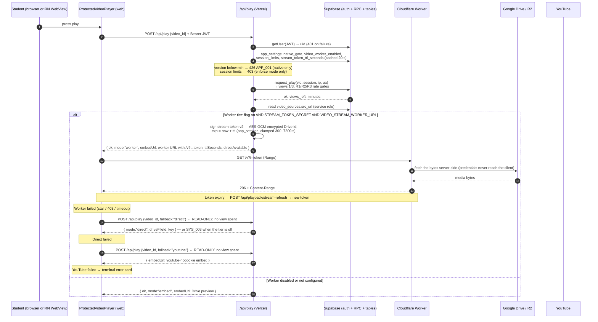

# KineTech — system map

Companion to [`docs/ARCHITECTURE.md`](ARCHITECTURE.md) (the layering rules).
This file is the **operational** map: which pieces exist, what happens when a
student presses play, where every configuration value lives, how the system
breaks and what to check first.

Everything below was read out of the code, not assumed. Re-verify with the
commands in §7 after every change.

---

## 1. Components

| Component | Where | Responsibility | Holds secrets |
|---|---|---|---|
| **Web app** | `apps/web` (React 19 + Vite) | Student + admin UI. Hash router (`#/…`). The only player is `src/components/ProtectedVideoPlayer.tsx`. | No (only `VITE_*` = public) |
| **RN shell (WebView)** | `apps/mobile` (Expo 58 / RN 0.88) | Loads the web app in a WebView, adds the native player (`app/player.tsx`, `expo-video`), screen-capture detection, the update gate and the WhatsApp link. | No (`EXPO_PUBLIC_*` = public) |
| **Message bridge** | `packages/bridge` + `apps/mobile/src/bridge.ts` | Web ↔ native messages. The native side validates the sender origin against `ALLOWED_ORIGINS` and validates the payload schema. **A playable URL never crosses the bridge.** | No |
| **Vercel functions** | `apps/web/api/*.ts` | The only door to a watchable URL. 12 self-contained route handlers (`_logger.ts` is the reference logging template — every handler inlines its own copy, because Vercel's bundler cannot follow relative imports in this folder). | Yes (env only) |
| **Supabase** | project `kinetech-db` | Auth, Postgres, RLS, RPCs (`request_play`, `record_play`, `complete_video`, …), `app_settings`, `app_logs`. | Yes (service-role key) |
| **Worker (R2)** | `backend/video-worker` — name `kinetech-video` | Serves the encrypted HLS lessons from the **private** R2 bucket `kinetech`. Token in the query string, Range support, no CORS `*`. | Yes (`GRANT_SECRET` secret) |
| **Worker (Drive)** | `apps/worker-video` — name `kinetech-video-test` | Prototype worker that streams **Google Drive** bytes through the Cache API. Used by the *web* Worker tier. | Yes (`STREAM_TOKEN_SECRET`, `DRIVE_CREDENTIALS`) |
| **Google Drive** | external | The lesson files (private, "anyone with the link" for the API-key mode) and the Drive preview embed for the Direct tier. | — |
| **YouTube** | external | Last-resort tier (`youtube-nocookie` embed). | — |
| **R2** | Cloudflare bucket `kinetech` | Encrypted HLS segments + AES keys (only reachable through the Worker). | — |
| **CI** | `.github/workflows/ci.yml` | Unit (Vitest) + E2E (Playwright) on Node 24, on every PR to `main`. | — |

> **Two worker stacks exist** (they are independent, with different secrets):
> the **native/R2** stack (`GRANT_SECRET` + `VIDEO_WORKER_BASE_URL` → `kinetech-video`)
> and the **web/Drive** stack (`STREAM_TOKEN_SECRET` + `VIDEO_STREAM_WORKER_URL` →
> `kinetech-video-test`). Do not mix their secrets.

---

## 2. "Student presses play"



**Where the (up to) three `/api/play` calls come from** — all three in
`apps/web/src/components/ProtectedVideoPlayer.tsx`:

| # | Call | When | View spent? |
|---|---|---|---|
| 1 | `{ video_id }` | on mount (and on a manual retry) | **Yes** — `request_play` counts it (3 per lesson) |
| 2 | `{ video_id, fallback:"direct" }` | the Worker tier died | No — the fallback branches run *before* `request_play` |
| 3 | `{ video_id, fallback:"youtube" }` | the Direct tier died | No |

The tier order is **Worker → Direct Drive → YouTube → terminal error card**.
The transitions are decided by the pure reducer in `apps/web/src/lib/playerTiers.ts`;
the component only renders what the reducer names.

**Native path (no WebView player):** `app/player.tsx` → bridge `play` →
`POST /api/playback/start` (device-bound grant, `GRANT_SECRET` +
`VIDEO_WORKER_BASE_URL`) → the R2 worker playlist URL → `expo-video`.
`/api/playback/refresh` renews a grant **without** spending a view.

---

## 3. Runtime flags (`app_settings`)

Service-role-only table (`RLS` on, 0 policies). Read by the API with a 20 s
cache; written only through `POST /api/admin/app-settings` (admin JWT,
server-side `profiles.role` check) and audited in `app_settings_audit`.

| Key | Value shape | Default | Effect |
|---|---|---|---|
| `video_worker_enabled` | `{enabled}` | `true` | When false, `/api/play` never returns a Worker URL (log `api.play.worker_disabled`). |
| `direct_drive_enabled` | `{enabled}` | `true` | When false, the Direct tier answers `SYS_003` — the Drive file id and the browser key are **never** handed out. |
| `session_limits` | `{mode, max_concurrent_sessions, max_concurrent_devices, heartbeat_ttl_minutes, ip_binding}` | `mode:"log"`, 2 sessions, 3 devices, 30 min, ip off | `log` = record only; `enforce` = `403 TOO_MANY_SESSIONS` / `TOO_MANY_DEVICES`. A session stops counting after the heartbeat window. IP binding is off by default (mobile networks rotate the IP mid-lesson). |
| `stream_token_ttl_seconds` | `{seconds}` | `3600` | Lifetime of a **copied** Worker stream URL. Clamped server-side to 300..7200 s. The player refreshes at a fifth of the lifetime (min 30 s, max 5 min). |
| `native_gate` | `{gate_enabled, min_supported_version, force_update, message_ar, message_en}` | `gate_enabled:true`, `min "0.0.0"`, `force_update:false` | Version gate for the native app. Below the minimum → `426 APP_001` on `/api/play`; plain browsers are never blocked. |

**Fail-safe rule:** every flag read is fail-open. A missing row, a broken
value or an unreachable DB keeps the previous behaviour (and logs
`api.play.*` / `api.app-settings.*`). The exception is the version gate, which
fails open too (`min "0.0.0"` = nobody is blocked).

---

## 4. Tokens — what a student can see

| Grant | Signed with | TTL | Carries | Student sees |
|---|---|---|---|---|
| Web stream token (`apps/web/src/lib/streamToken.ts`, copies in `api/play.ts` + `api/playback/stream-refresh.ts`) | `STREAM_TOKEN_SECRET` (HMAC-SHA256 + AES-GCM) | `stream_token_ttl_seconds` (300..7200 s) | user id, **encrypted** Drive id, exp, jti | The Worker URL with `?t=` — the Drive id is inside the ciphertext |
| Native grant (`packages/playback-token`, `api/playback/start.ts`) | `GRANT_SECRET` | short, device-bound | user id, lesson id, device id | only a playlist URL, inside the native app |
| Session JWT | Supabase auth | ~1 h | user identity | the access token (in memory) |

The **Direct Drive tier** is the weak link: it returns the Drive file id and
the browser key to the page, so it can be turned off server-side
(`direct_drive_enabled`). The **watermark** (email + last 4 phone digits)
drifts over the player on every tier.

---

## 5. Config / env map

### Client bundle (public — visible to every visitor)

| Var | Where | Used by |
|---|---|---|
| `VITE_SUPABASE_URL` | Vercel env (Preview + Production) | `apps/web/src/lib/db/env.ts` |
| `VITE_SUPABASE_ANON_KEY` (+ legacy alias `VITE_SUPABASE_PUBLISHABLE_KEY`) | Vercel env | same — the anon key is public by design (RLS is the guard) |
| `EXPO_PUBLIC_SUPABASE_URL`, `EXPO_PUBLIC_SUPABASE_ANON_KEY` | mobile `.env` / EAS | `apps/mobile/src/supabase.ts` |
| `EXPO_PUBLIC_API_BASE_URL`, `EXPO_PUBLIC_WEB_URL` | mobile `.env` / EAS | `apps/mobile/src/config.ts`, `playback.ts` |

### Vercel functions (secret — never from the client)

| Var | Used by | Notes |
|---|---|---|
| `SUPABASE_URL`, `SUPABASE_ANON_KEY`, `SUPABASE_SERVICE_ROLE_KEY` | every API handler | the service role reads `video_sources`, `app_settings`, `app_logs` and writes the audit rows |
| `GRANT_SECRET` | `api/playback/{start,refresh}.ts`, `api/config.ts` | must equal the `kinetech-video` worker secret |
| `VIDEO_WORKER_BASE_URL` | `api/playback/{start,refresh}.ts` | origin of the R2 worker |
| `STREAM_TOKEN_SECRET` | `api/play.ts`, `api/playback/stream-refresh.ts` | must equal the `kinetech-video-test` worker secret |
| `VIDEO_STREAM_WORKER_URL` | `api/play.ts`, `api/playback/stream-refresh.ts` | origin of the Drive worker (web tier) |
| `DRIVE_BROWSER_KEY` | `api/play.ts` (Direct tier only) | a Google API key restricted by HTTP referrer + API scope — it lands in the page, so the restriction is the only real guard |
| `GOOGLE_API_KEY` | `api/drive-minutes.ts`, `api/admin/video-meta.ts` | server-side Drive metadata probe |
| `LOG_LEVEL` | client + server loggers | optional minimum level |
| `VERCEL_ENV`, `VERCEL_GIT_COMMIT_SHA` | injected by Vercel | logged with every line |

### Worker secrets (Cloudflare)

| Worker | Secrets | State |
|---|---|---|
| `kinetech-video` (`backend/video-worker`) | `GRANT_SECRET` | **not deployed** on the Cloudflare account (error 10007) |
| `kinetech-video-test` (`apps/worker-video`) | `STREAM_TOKEN_SECRET`, `DRIVE_CREDENTIALS`, `ALLOWED_ORIGINS` | deployed 2026-11-22/23, carries the owner's **test** Drive key |

### CI (GitHub Actions secrets)

`VITE_SUPABASE_URL`, `VITE_SUPABASE_ANON_KEY` for the Unit and E2E jobs.

### Retired / not used

`VITE_DRIVE_BROWSER_KEY` is no longer read by any code (the test page asks
for the key in the page). Delete it from Vercel — a `VITE_*` var is inlined
into the public bundle. `EXPO_PUBLIC_GOOGLE_API_KEY` was removed from
`apps/mobile/.env.example` (unused, and `EXPO_PUBLIC_*` is shipped inside the
app package).

---

## 6. Failure modes

| Component | What breaks it | Student sees | How I detect it | Fix / mitigation |
|---|---|---|---|---|
| Drive quota | Drive answers 429/403 → the Worker turns it into 502 | the chain falls forward to the next tier; if all tiers fail, the error card | `wrangler tail`, `api.play.worker_failed` / `player.tier_fallback` logs | rotate the key / add a second credential (`DRIVE_CREDENTIALS` is a pool) |
| Worker | first frame > 4 s, or the Worker answers 5xx | the Worker tier fails → Direct → YouTube | `player.tier_fallback` (warn) with `from`/`to` | the fallback is the design; check `video_worker_enabled` |
| Worker | the R2 worker `kinetech-video` is not deployed | the **native** path cannot play at all | `npx wrangler deployments list --config backend/video-worker/wrangler.toml` → "does not exist" | deploy it, set `GRANT_SECRET` on both sides, point `VIDEO_WORKER_BASE_URL` at it |
| Worker | Range is not honoured (no 206 / no `Content-Range`) | seeking breaks, buffering | `curl -H "Range: bytes=0-1023" -i <worker-url>` | the Worker sets `Accept-Ranges`; check the cache-hit path |
| Stream token | expires mid-playback | the stream stops | client refresh error / `api.playback.stream-refresh` failures | the player renews at a fifth of the TTL; a shorter TTL means more `/stream-refresh` calls (Vercel function invocations) |
| Clock skew | server and client disagree about the time | the token is rejected as expired (403) | `expired` in the worker answer | the token carries the server's clock; the skew tolerance lives in `packages/playback-token` |
| Supabase | the DB is unreachable | `/api/play` cannot gate → the student sees an error card (the gate *must* reach the DB) | `npm run logs -- --source db --level error --since 1h` | the flag reads fail open; the play gate does not (by design) |
| Vercel env | a Production-scope var is missing | the Worker tier is silently skipped (`api.play.worker_skipped` says which side is missing) | that log line names the missing side | set the var and redeploy (an env change needs a redeploy) |
| Local tooling | Node < 24 on the machine | vitest/rolldown crash (`styleText` is missing) | `node -v` | `export PATH="$HOME/.nvm/versions/node/v24.22.2/bin:$PATH"` |
| WebView | the device has no Fullscreen API | the expanded player cannot go full screen | the RN console / the expanded-player debug strip | the web player offers its own buttons; the native path uses `expo-video` |
| WebView | the scroll lock leaks | the page cannot scroll after the player collapses | manual on a device | `apps/web/src/lib/useScrollLock.ts` releases on unmount; `useScrollLock.test.ts` covers it |
| Vercel | a failed build is promoted | everyone gets the broken build | `gh run list` (CI must be green), the Vercel deployment status | the PR is the gate: never promote a red build |
| Version gate | `min_supported_version` is set too high (or `gate_enabled` is wrong) | **every native student is blocked** (426) — the worst failure mode | `app_settings.native_gate`; `APP_001` in the logs | the gate is fail-open by default (`"0.0.0"`); the admin can switch it off in one click |
| Session limits | `mode:"enforce"` with a short heartbeat window | `TOO_MANY_SESSIONS` / `TOO_MANY_DEVICES` (403) | the codes in the logs + the limit shape in the error message | keep `mode:"log"` while measuring; the heartbeat window must be longer than a lesson |
| Session limits | self-signup is open on Supabase | a student can reset the 3-view cap by making a new account | `auth.signUp` in the network tab | switch off "Allow new users to sign up" in the Supabase dashboard (owner action) |
| Flags | `video_worker_enabled` left off while `kinetech-video` is missing | the Direct tier is the only path (it exposes the Drive id + key) | the admin dashboard + the tier history in the player debug strip | deploy the worker, then switch the tier on |
| Logging | the client logs never arrive | a silent failure (the UI still works) | `npm run logs -- --source db --level error --since 1h` | `/api/log` answers `CONFIG_MISSING` when the service-role key is missing in that scope; the table `app_logs` is applied |

---

## 7. Runbook — what to check first

```bash
# 0. Node 24 (the repo requires it: .nvmrc, root engines)
export PATH="$HOME/.nvm/versions/node/v24.22.2/bin:$PATH"
node -v

# 1. CI / the PR
gh run list --branch feat/plan-v2-tasks --limit 5
gh run view <run-id> --log-failed

# 2. Local gates (same as CI)
npm run test:unit      # web vitest + playback-token + video-source + worker
npm run build          # tsc -b && vite build
npm run lint
bash scripts/verify.sh full

# 3. Logs — one request id from the UI toast / the error response
npm run logs -- --request <request-id> --since 30m
npm run logs -- --source db --level error --route /api/play --since 1h
npm run logs -- check --file /tmp/run.jsonl        # validate against docs/LOGGING.md

# 4. The Workers
npx wrangler tail --config backend/video-worker/wrangler.toml
npx wrangler deployments list --config backend/video-worker/wrangler.toml
npx wrangler secret list --config apps/worker-video/wrangler.toml
curl -s https://<worker>.workers.dev/health

# 5. The database (read-only)
#    Supabase dashboard → SQL editor, or the management API (never print values)
select key, value from app_settings order by key;

# 6. Vercel
#    Dashboard → the deployment list; `vercel logs <deployment-url>` if the CLI
#    is logged in (it is not, by default, in this environment).

# 7. The native app
#    Android: chrome://inspect → the WebView (dev build only)
#    iOS: Safari → Develop → <device> → the WebView (dev build only)
#    Expo Go cannot run the native security module (root/emulator/capture
#    detection) — use `npx expo run:android` or an EAS build.
```

**Reading an error the student reports:** ask for the **request id** (shown in
the error toast, in the response body and in the browser console). Then run
step 3 with it — the chain UI → API → DB is in one query.

---

## 8. Free-tier budget (what each choice costs)

| Component | Free limit | How this project stays inside it |
|---|---|---|
| Worker requests | 100 000 / day | one stream = 1 request + Range requests; the Drive worker caches chunks in the Cache API |
| Worker CPU | 10 ms / request | the Worker only signs/verifies and proxies bytes |
| Vercel functions | Hobby free tier — check the dashboard for the current quota | 1 `/api/play` per lesson + 1 per tier fallback + 1 token refresh per TTL window |
| Supabase | 500 MB DB, 5 GB egress | `watch_events` is purged after 90 days on every play request |
| R2 | 10 GB stored, 1M reads / month | only the Worker reads the bucket |
| GitHub Actions | 2 000 min / month | 2 jobs (unit + e2e) per PR |

**Request-count growth to watch:** shortening `stream_token_ttl_seconds`
raises the number of `stream-refresh` calls (one per TTL window per playing
student) and, on the native side, the number of `playback/start` calls.
